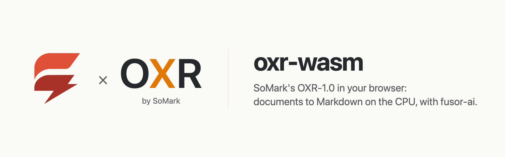

<p>
  <picture>
    <source media="(prefers-color-scheme: dark)" srcset="assets/brand/banner-dark.png">
    
  </picture>
</p>

# Documents to Markdown in the browser, on the CPU

**[Try it in your browser](https://huggingface.co/spaces/fusorlabs/oxr-wasm)**: no install, no server. The model downloads once and runs on your CPU.

**A formula read to its first token in 1.3 s, the answer written at up to 210 tokens a second**, in Chrome on an Apple M4 Pro, eight threads. [Benchmarks](benchmarks.md)

Drop, paste or pick an image of a document and get it back as Markdown: a whole page in reading order, or a region's text, a table, a formula, code or a chemical structure, read by SoMark's [OXR-1.0](https://huggingface.co/SoMarkAI/OXR-1.0), a 1.3B vision-language model for document parsing, computed on your own device. No server, no API key, no GPU required, and once the model has loaded, no image leaves the page.

oxr-wasm is the app around the model: a [fusor](https://github.com/fusor-rs/fusor) page, the browser runtime and a native CLI. The model itself, compiled to WebAssembly, is built with [fusor-ai](https://github.com/fusor-rs/fusor-ai), the toolkit for AI runtimes in Rust and WebAssembly, from the published weights.

**In development · v0.1**: this is experimental software. See [status and known limitations](#status-and-known-limitations).

[Run it](#run-it-locally) · [Try it online](#try-it-online) · [How it works](#how-it-works) · [How fast is it](#how-fast-is-it) · [Benchmarks](benchmarks.md) · [Status](#status-and-known-limitations) · [Contributing](CONTRIBUTING.md)

## Run it locally

You need Rust 1.99 or newer, installed with [rustup](https://rustup.rs), Node.js 22 or newer and [`just`](https://github.com/casey/just). Then:

```sh
git clone --recurse-submodules https://github.com/fusor-rs/oxr-wasm && cd oxr-wasm
just ui
```

and open the address it prints. That's all: `just ui` installs the pinned tools (the threads toolchain with rustup; wasm-bindgen, binaryen and the fusor CLI into `.tools/`), downloads the checkpoint at a pinned revision (3.1 GB, each file sha256-checked), compiles it into a 1420 MB bundle, builds the four browser runtimes (a few minutes the first time, seconds after) and the page, and serves it on `http://localhost:8787` with the bundle beside it.

Drop an image on the page, paste one, or choose a file; pick what to read it as (**Whole page**, **Text**, **Table**, **Formula**, **Code** or **Chemical structure**) and press **Read**, even while the model is still loading: the image is read the moment the model is ready. The answer appears token by token, drawn as it is written: tables as tables, formulas typeset with KaTeX, code in its own block, with the Markdown below to copy. Every reading is measured live: the time to the answer's first token, the tokens written per second, the size the image was resized to and its tokens, and the network requests since the model loaded, which stay at zero.

## Try it online

Open the Hugging Face Space [fusorlabs/oxr-wasm](https://huggingface.co/spaces/fusorlabs/oxr-wasm) in Chrome or Edge. The page downloads the 1420 MB model once and keeps it in the browser's storage, so the next visit loads in about a second.

## More ways to run it

### Build everything from source

```sh
just build    # also downloads the checkpoint (3.1 GB, sha256-checked) and compiles the bundle
just serve
```

`CHECKPOINT=<dir>` reuses a checkpoint you already have, `PROFILE=q7` compiles the 1571 MB bundle with every large matrix in 7 bits, and `PROFILE=f32` the 5.5 GB full-precision one that `just parity` checks against the reference.

### The CLI

The CLI reads PNG and JPEG files without a browser:

```sh
target/release/oxr read dist/model page.png
target/release/oxr read dist/model invoice.jpg --task table
```

`oxr bench` measures each stage on an image and `oxr parity` compares every stage with the reference's outputs.

## How it works

- **The model runs in your tab.** The runtime is OXR-1.0 compiled to WebAssembly with fusor-ai: the image is resized so both sides are whole 32-pixel blocks within SoMark's pixel budget and cut into 16×16 patches; a 27-layer SigLIP2 NaViT encoder reads all of them at once, each patch turned by its row and column (2-D rotary embeddings) and given the learned position grid resampled to the image; every 2×2 block of encoded patches becomes a probability distribution over a visual vocabulary of 65 532 words, and its token is the mixture of their embeddings; and Qwen3 0.6B reads the prompt with the image's tokens in it and writes the answer greedily.
- **The reference's pixels, exactly.** The resize is Pillow's bilinear filter reimplemented to the bit, fixed-point rounding included, and the position grid is resampled as PyTorch's bicubic interpolation does it; the prompt's ids are the reference's one for one, and every stage but the vision encoder's attention agrees with PyTorch within 2·10⁻⁵.
- **The visual vocabulary as one product.** A token's distribution is nearly flat (its most likely word holds 0.3% of it, the 4096 likeliest a third), so no shortcut over a few words reproduces it. The runtime keeps the embedding table transposed, so mixing a block of tokens' 65 536 probabilities into their embeddings is one matrix product on the same int8 kernels as the weights, each thread quantizing its own share of the probabilities once; and the vocabulary's logits are computed 64 tokens at a time, so a page's 900 tokens never hold 236 MB of them at once.
- **Only what the model reads.** The vision tower's final norm (the model reads the last layer's output as it is), its windowed reordering (every layer attends to the whole image, so the order changes nothing) and the language model's input embeddings (they are its head's rows) are left out of the bundle and the computation.
- **Long attention, in int8.** A page is up to 3600 patches that all attend to each other. Each thread quantizes a head's keys and values once per layer (the keys' mean subtracted first, which the softmax ignores) and runs both products on the same int8 kernels as the weights.
- **Quantized where it holds.** The visual head is 4-bit and everything else 7-bit, 1420 MB in all against the checkpoint's 3.1 GB. The vision layers and the language model keep 7 bits: in 4 they read the fixed images the same but lose a dense table ([benchmarks](benchmarks.md#agreement-with-the-reference)).
- **One stage per step.** The engine worker reads in steps (the vision tower and the visual vocabulary, the prompt, then one token of the answer at a time) and posts the answer after each, so the text streams and Stop takes effect between tokens.
- **Threads and SIMD where the browser has them.** The page picks one of four builds: worker threads when it is cross-origin isolated, relaxed SIMD when the engine supports it, plain SIMD128 everywhere else.
- **Downloaded once, verified always.** The bundle streams in parts, each checked against its BLAKE3 hash, and stays in the browser's origin-private storage, so the next visit loads from this device in about two seconds.
- **Sealed.** The runtime imports no network, storage, clock or entropy capability; fusor-ai's import check proves it on every build. The page counts its network requests while it reads, and the count is zero.
- **A fusor page.** The image, the task, the answer and the measurements are Rust signals with HTML templates; the answer is split into text, formulas, code and tables in Rust, and a table's cells are drawn as text, never as the model's HTML. A small JavaScript module decodes the image, runs the engine worker and typesets the formulas.

## How fast is it

On an Apple M4 Pro in Chrome on eight threads, the page reads a formula to its first token in 1.3 s and a photographed book page, 2992 patches, in 5.3 s, then writes the answer at 170–210 tokens per second; on one thread, 7.3 s and 32 s. The five test images read as the PyTorch reference reads them, one formula differing only in where its alignment mark sits. [benchmarks.md](benchmarks.md) has the full measurements, in Chrome, in Node and natively against PyTorch, including the ones where we lose:

<picture>
  <source media="(prefers-color-scheme: dark)" srcset="assets/benchmarks/benchmarks-dark.png">
  
</picture>

Natively, PyTorch reaches the first token on large images 1.1–1.3× sooner: its f32 matrix products run on the M4's matrix units through Apple's Accelerate, while fusor-ai's int8 kernels are written for WebAssembly SIMD first. Once the answer starts, fusor-ai writes it 7–8× faster.

## Documentation

| Guide | Covers |
| --- | --- |
| [Benchmarks](benchmarks.md) | Time to the first token, tokens per second, agreement with the reference and download, and how to reproduce them |
| [Contributing](CONTRIBUTING.md) | Setup, checks, the reference, moving fusor-ai, deploying |
| [AGENTS.md](AGENTS.md) | The code standard every change follows |

## Status and known limitations

oxr-wasm is v0.1 and experimental.

### Platform status

| Platform or capability | Status |
| --- | --- |
| Chrome and Edge, threads and relaxed SIMD | Headless Chrome end-to-end check (`just e2e`): read while loading, a table, a formula, a book page, revisit |
| Browsers without relaxed SIMD (Safari, older Firefox) | SIMD128 builds, checked in Node (`just smoke`), about a third as fast as relaxed SIMD; not tested in those browsers |
| Pages without cross-origin isolation | Single-threaded builds: 7 s to a formula's first token, about 30 s for a page on an Apple M4 Pro |
| Native CLI (macOS on Apple silicon) | Built and measured; no release archives yet |
| Phones | Not measured; the threaded builds' memory may grow to 4 GB |

**Not supported yet:**

- SoMark's layout pipeline: OXR's service first finds a page's regions with a separate layout model (D-FINE) and reads each one, then orders them. Here the model reads the image you give it under one task: a whole page in one pass, or a region you cropped.
- PDFs: the page reads images; render a PDF's pages to images first.
- Answers longer than 4096 tokens.
- A GPU backend.

The model is SoMark's [OXR-1.0](https://huggingface.co/SoMarkAI/OXR-1.0), under the [OXR License](https://huggingface.co/SoMarkAI/OXR-1.0/blob/main/LICENSE): Apache-2.0 with additional terms on commercial use above a funding or revenue threshold, on attributing SoMark OXR in online services, and against offering a competing hosted API. The bundle ships it beside the weights (`model/LICENSE`). The test images are PaddleOCR's own test files (Apache-2.0), downloaded at a pinned commit.

## How is this different from SoMark's OXR?

[OXR](https://github.com/SoMarkAI/OXR) is SoMark's own service for the model: Python, vLLM and a layout model on a server with an NVIDIA GPU, with a document parsing API. oxr-wasm is a separate implementation on fusor-ai: the same weights, its own kernels, preprocessing and decoding, with every stage checked against the PyTorch reference, running in the browser.

## How is this different from a cloud OCR API?

A cloud API sends your documents to a server and bills per page. oxr-wasm runs on your device after a one-time download: it works offline, costs nothing per page, and your images never leave the page.

## Contributing

oxr-wasm is an open source project in early development. The [contributing guide](CONTRIBUTING.md) covers the setup, checks and workflow. The page lives in `app/`; the runtime and the CLI live in fusor-ai's `models/oxr`; the model and its toolkit come from fusor-ai, its crates and browser scripts from the `vendor/fusor-ai` submodule.

oxr-wasm is built with the help of AI tools, mainly Claude Code, under the same rules the project asks of contributors: see [Using AI tools](CONTRIBUTING.md#using-ai-tools).

## License

The code is licensed under the [MIT License](LICENSE). The model's weights are SoMark's, under the [OXR License](https://huggingface.co/SoMarkAI/OXR-1.0/blob/main/LICENSE).
